# TraceDon · Cahier des charges des parcours utilisateurs

> **Version 1.1 · 9 octobre 2026** (intègre les décisions de Bruno sur les questions ouvertes, voir annexe C) · rédigé pour l'équipe qui reconstruit l'application TraceDon (nom technique actuel : « Dons Invendus »).
> Ce document décrit le **comportement attendu** de l'application, rôle par rôle. Il est indépendant de la technologie : il ne présuppose ni le framework, ni la base de données, ni l'hébergeur. L'application actuelle (V1) ne sert que de référence ; ses écarts et ses pièges sont listés en annexe pour ne pas les reproduire.

---

## 0. Comment lire ce document

**Les trois rôles** : l'**Entreprise** donatrice, l'**Association** bénéficiaire, le **Coordinateur** qui supervise la plateforme.

**Chaque étape d'un parcours** est décrite par une fiche :

- **Objectif** : ce que la personne veut accomplir.
- **Écran** : ce qu'elle voit et saisit.
- **Ce qui se passe** : les effets dans l'application et chez les autres rôles.
- **Règles** : les contrôles. Un contrôle **bloquant** empêche l'action ; un **avertissement** informe mais laisse continuer.
- **Cas particuliers**.
- **Critères de recette** : comment vérifier que l'étape est bien faite.

**Repères** :

- 🆕 **Nouveau** : n'existait pas dans la V1, à concevoir.
- 🔧 **Corrigé** : existait dans la V1 avec un défaut ; le comportement décrit ici est le bon.
- ❓ **À confirmer** : hypothèse raisonnable de la rédaction, à valider avec Bruno avant de coder.

**Vocabulaire** : un *don* regroupe des *articles* ; il est remis via un *bon d'enlèvement* signé par les deux parties ; une *convention* encadre la relation entre une entreprise et une association ; le *reçu fiscal* est émis par l'association à la demande de l'entreprise. Le lexique réglementaire (loi Garot, AGEC, RNA, DDPP, RUP…) est en fin de document.

---

## 1. Vue d'ensemble

### 1.1 Ce que fait le produit

TraceDon digitalise et sécurise la traçabilité des dons d'invendus **alimentaires et matériels** entre des entreprises (commerces, grande distribution, restauration, magasins non alimentaires) et des associations caritatives. Il couvre toute la chaîne : déclaration de l'invendu, mise en relation, contrôle et signature à la remise, preuves pour la conformité (lois Garot et AGEC), justificatifs fiscaux, et mesure de l'impact écologique.

**Ce qui ne doit jamais casser : le flux de don lui-même**, de la déclaration à la remise signée.

### 1.2 Les rôles

| Rôle | Qui | Ce qu'il fait principalement |
|---|---|---|
| Entreprise | Un établissement identifié par son SIRET (un magasin, un restaurant…) | Déclare et publie des dons, signe les bons, demande les reçus fiscaux |
| Association | Une association identifiée par son RNA | Trouve et réclame des dons, contrôle sur place, signe les bons, émet les reçus fiscaux |
| Coordinateur | L'équipe TraceDon | Supervise, vérifie les associations, attribue les dons restés sans preneur, suit la conformité et l'impact |

Le **bénévole** d'une association n'est **pas** un utilisateur de l'application : il n'a pas de compte. Il est enregistré dans le profil de l'association, et c'est le compte de l'association qui signe pour lui (son nom est tracé sur le bon).

### 1.3 Les deux natures de don

| | Don alimentaire | Don matériel |
|---|---|---|
| Exemples | Produits frais, épicerie, boulangerie, plats | Mobilier, textile, électroménager, hygiène, high-tech |
| Cadre légal principal | Loi Garot (commerces > 400 m²) | Loi AGEC (interdiction de détruire les invendus neufs) |
| Suivi sanitaire | Oui : date limite (DLC/DDM), température, allergènes, contrôle des rappels produits | Non |
| Poids | Oui, sert au suivi et au calcul du CO₂ | Non obligatoire |
| Partage entre associations | Non : un don = une association | Oui si le don est déclaré **divisible** |
| Articles obligatoires à la publication | Non : la liste peut être faite au moment de l'enlèvement | Oui, au moins un |

L'entreprise déclare à l'inscription sa **nature d'activité** (alimentaire, non alimentaire, ou les deux), qui détermine les types de dons qu'elle peut créer.

### 1.4 Les objets manipulés

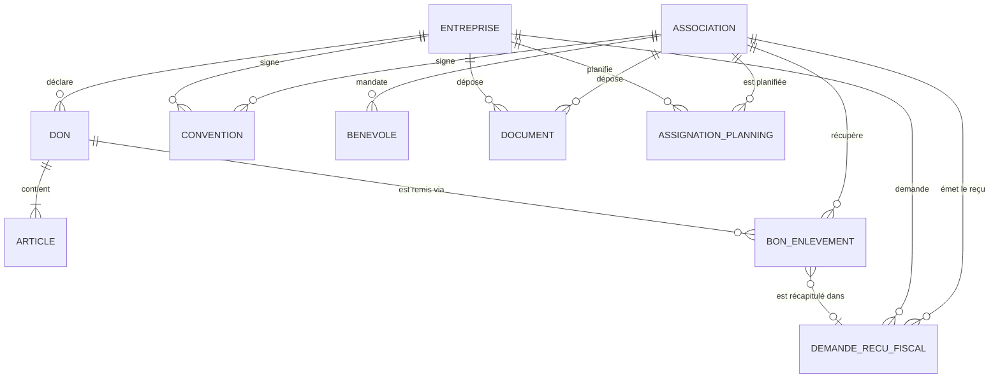

Autres objets : utilisateur (compte de connexion), attestation d'intérêt général, conversation et message, période de congés, abonnement aux notifications, préférences d'alerte.

### 1.5 Le parcours d'un don, en un schéma

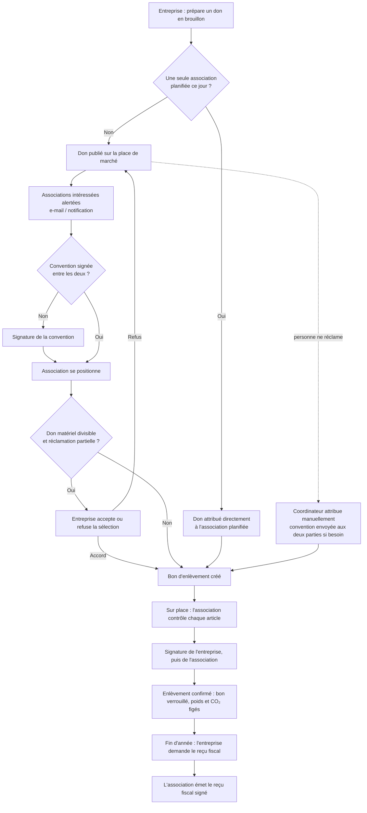

---

## 2. Parcours Entreprise

### 2.0 Le parcours en un coup d'œil

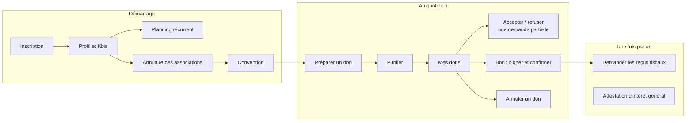

Navigation principale de l'entreprise : **Nouveau don · Mes dons 🆕 · Planning · Messages · Archives · Profil**.

### E1 · S'inscrire

- **Objectif** : créer le compte de l'établissement.
- **Écran** :
  - type de compte « Entreprise » ;
  - recherche assistée dans la base officielle des entreprises (SIRENE), qui pré-remplit raison sociale, SIRET, adresse, forme juridique ;
  - adresse avec auto-complétion (pour obtenir les coordonnées GPS) ;
  - nature d'activité : alimentaire / non alimentaire / les deux ;
  - nom du contact, e-mail, mot de passe et confirmation.
- **Ce qui se passe** : l'établissement et le compte utilisateur sont créés **ensemble** (tout ou rien), puis la personne est connectée et arrive sur « Nouveau don ».
- **Règles** :
  - SIRET : 14 chiffres, bloquant. ❓ Contrôle de validité de la clé et d'existence du SIRET dans la base officielle.
  - E-mail unique, bloquant. Mot de passe d'au moins 8 caractères, bloquant.
  - 🆕 **Vérification de l'adresse e-mail** par lien de confirmation (décision de Bruno) ; tant qu'elle n'est pas vérifiée, le compte ne peut ni publier ni signer.
  - La personne qui crée le compte devient **administratrice** de l'organisation (voir E2).
  - Le Kbis n'est **pas** demandé à l'inscription : il est exigé à la première publication (E9).
  - Limite anti-abus : 5 inscriptions par heure et par connexion internet.
- **Cas particuliers** : recherche SIRENE indisponible → saisie manuelle possible ; adresse sans coordonnées GPS → les distances s'affichent « — ».
- **Recette** : inscription complète en moins de 2 minutes ; un SIRET à 13 chiffres est refusé ; un e-mail déjà utilisé est refusé ; si la création du compte échoue, aucun établissement orphelin ne reste en base.

### E2 · Se connecter, gérer son compte

- **Objectif** : accéder à son espace en sécurité.
- **Écran** : e-mail, mot de passe ; 🆕 lien « Mot de passe oublié » (réinitialisation par e-mail).
- **Règles** : 10 tentatives par 5 minutes et par e-mail ; session de 7 jours maximum ; mots de passe jamais stockés en clair (hachage à sens unique).
- 🆕 **Plusieurs utilisateurs par organisation, avec niveaux d'accès** (décision de Bruno ; valable aussi pour les associations) :
  - l'administrateur invite des collègues par e-mail, choisit leur niveau, peut le modifier ou retirer l'accès ;
  - niveaux proposés ❓ (à valider avec Bruno) :

| Niveau | Peut faire |
|---|---|
| Administrateur | Tout : informations de l'organisation, utilisateurs, documents, conventions, reçus fiscaux, planning |
| Opérateur | Le quotidien : préparer et publier des dons (entreprise) ou se positionner (association), contrôler et signer les bons, messagerie |
| Lecture | Consulter les dons, bons, archives et l'impact, sans rien modifier |

- Les notifications vont aux utilisateurs concernés par leur niveau (❓ préférences par utilisateur).
- **Recette** : après 10 échecs, l'écran indique d'attendre ; la déconnexion invalide la session ; un utilisateur en lecture ne voit aucun bouton d'action et le serveur refuse ses actions.

### E3 · Compléter son profil et sa conformité

- **Objectif** : être en règle pour publier, et donner aux associations les informations utiles.
- **Écran** (rubriques du profil) :
  - **Coffre-fort documentaire** : Kbis (seul document obligatoire), remplaçable. 🆕 Possibilité de supprimer et date de dépôt mise à jour à chaque remplacement.
  - **Surface de vente** (m²) : au-delà de 400 m², l'entreprise est concernée par la loi Garot ; un encart l'explique.
  - **Référent don** : nom et téléphone de la personne à contacter, 🆕 visibles par les associations partenaires sur le bon et la fiche du don.
  - **Congés et fermetures** : périodes avec date de début, de fin et motif.
  - **Notifications** : activer les notifications sur l'appareil ; 🆕 choisir ses canaux (e-mail, notification).
  - **Impact cumulé** : kilos donnés, CO₂ évité, équivalent en kilomètres de voiture, nombre de dons.
  - 🆕 **Informations de l'établissement modifiables** : raison sociale, adresse, nature d'activité, e-mail de connexion (le SIRET reste fixe).
  - Consentement à la mesure d'audience, modifiable.
- **Règles** :
  - Sans Kbis déposé, toute publication est **bloquée** (E9) avec un lien vers le coffre-fort.
  - Fichiers : PDF, JPEG, PNG ou WebP, 5 Mo maximum ; 30 envois par heure.
  - 🔧 **Congés** (décision de Bruno) : pendant la période, les **dons récurrents** (attributions automatiques du planning, E4) sont **suspendus automatiquement**, y compris pour une période déclarée à l'avance (un traitement planifié s'en charge au premier jour). L'entreprise peut **réactiver manuellement** un jour ou une association du planning pendant la période. Les associations concernées sont prévenues de la suspension. Les dons ponctuels déjà publiés ou pris en charge ne sont pas annulés automatiquement : l'entreprise peut les annuler (E13). ❓ Publication d'un don ponctuel pendant les congés : autorisée avec un avertissement « vous êtes en congés ».
  - Toutes les dates s'entendent dans le fuseau **Europe/Paris**.
- **Recette** : publier sans Kbis affiche le blocage et le lien ; avec des congés du lundi au mercredi, l'association planifiée le mardi ne reçoit pas de don le mardi, sauf si l'entreprise a réactivé ce jour-là.

### E4 · Planifier des partenaires récurrents

- **Objectif** : automatiser l'attribution du don quotidien à un partenaire attitré (cas typique d'une grande surface).
- **Écran** : les 7 jours de la semaine ; pour chaque jour, une ou plusieurs associations, ajout et retrait.
- **Ce qui se passe** : à la publication (E9), s'il y a **exactement une** association planifiée ce jour-là, le don lui est attribué directement ; s'il y en a plusieurs ou aucune, il est publié sur la place de marché.
- **Règles** :
  - Ajouter une association exige une **convention signée** avec elle (bloquant) ; sinon la convention est créée et l'entreprise est guidée vers sa signature (E6).
  - Entreprise > 400 m² et association non habilitée à l'aide alimentaire : **avertissement** (« la loi Garot demande au moins un partenaire habilité ») avec « Ajouter quand même ».
  - 🔧 Au moment de l'attribution automatique, l'application revérifie que la convention est toujours signée et que l'association n'est pas en congés ; sinon le don est publié sur la place de marché.
  - Pendant les congés de l'entreprise, les attributions du planning sont suspendues ; chaque jour ou association peut être réactivé manuellement (voir E3).
- **Recette** : une seule association le lundi → le don de lundi lui est attribué et elle est notifiée ; association en congés lundi → le don part sur la place de marché.

### E5 · Consulter l'annuaire et le dossier d'une association

- **Objectif** : choisir des partenaires de confiance.
- **Écran** : carte ou liste des associations, triées par distance réelle, avec badges : catégorie, « Habilitée » (affiché si l'entreprise dépasse 400 m²), « Chaîne du froid », « Vérifiée » par TraceDon, « Reconnue d'utilité publique » 🆕, capacité d'accueil (kg par collecte), nombre de bénéficiaires, congés en cours, présentation.
- 🆕 **Dossier détaillé** (en ouvrant une association) : habilitation (niveau, date de fin), déclaration DDPP, attestation chaîne du froid, assurances, statut fiscal (intérêt général, rescrit, RUP), disponibilités de retrait (jours × matin/après-midi), bénévoles référents (sans coordonnées personnelles ❓), et **les documents du coffre-fort de l'association, consultables** (décision de Bruno).
- 🆕 Actions depuis la fiche : « Proposer une convention », « Écrire » (si convention signée), « Ajouter au planning ».
- **Règles** : les documents sont consultables en lecture seule par les entreprises connectées ; chaque consultation est comptée dans la limite de téléchargements (7.2). L'association est informée, sur son coffre-fort, que ses documents sont visibles des entreprises.
- **Recette** : depuis la fiche d'une association, l'entreprise peut proposer une convention sans passer par le planning.

### E6 · Signer une convention de don

- **Objectif** : encadrer juridiquement la relation, préalable obligatoire à tout don entre les deux.
- **Ce qui se passe** : une convention unique par couple entreprise/association est créée (par l'entreprise depuis l'annuaire ou le planning, ou par l'association en se positionnant). Le document est généré à partir des informations des deux parties et signé électroniquement **dans l'application**.
- **Règles** :
  - 🔧 **Ordre de signature libre** : l'une ou l'autre partie peut signer en premier.
  - Statut « Signée » quand les deux ont signé.
  - 🆕 Notifications : l'autre partie est prévenue qu'une convention l'attend, puis que la convention est signée.
  - **Reconduction tacite** (décision de Bruno) : une fois signée, la convention reste valable sans date de fin ; ❓ prévoir une résiliation par l'une ou l'autre partie.
  - Une convention peut aussi être créée par le coordinateur lors d'une attribution manuelle (C3) : elle est alors envoyée automatiquement aux deux parties pour signature.
- **Recette** : l'association peut signer en premier sans erreur ; chaque partie est notifiée de la signature de l'autre.

### E7 · Préparer un don alimentaire

- **Objectif** : déclarer rapidement les invendus du jour.
- **Écran** (écran d'accueil d'une entreprise alimentaire) :
  - un **brouillon** est repris ou créé automatiquement ; titre et description sont pré-remplis avec ceux du dernier don ;
  - description au clavier ou **à la voix** (dictée, si le navigateur le permet) ;
  - pièce jointe : photo ou document (liste papier, ticket) ;
  - **extraction automatique** des articles depuis la pièce jointe, par IA ;
  - ajout d'articles par **scan de code-barres** (désignation, poids unitaire et allergènes récupérés depuis une base produits ouverte) ou **saisie manuelle** (désignation, quantité ou « vrac », poids, catégorie, allergènes parmi les 14 réglementaires) ;
  - adresse de récupération (par défaut celle de l'établissement) et instructions d'accès ;
  - bandeau indiquant ce qui se passera à la publication (attribution directe à X, ou place de marché).
- **Règles** :
  - **Rappel produit bloquant** : chaque code-barres est vérifié dans la base officielle des rappels (RappelConso). Un produit sous rappel actif ne peut pas être ajouté ; le motif et le lien vers la fiche officielle sont affichés. Contrôle refait côté serveur. Si la base est indisponible, l'ajout passe.
  - La liste d'articles n'est pas obligatoire pour publier un don alimentaire : elle peut être complétée sur le bon au moment de l'enlèvement.
  - 🔧 Relancer l'extraction ne crée pas de doublons (proposer de remplacer ou de compléter la liste).
  - 🔧 Chaque article porte une **catégorie** (même s'il vient d'un scan ou de l'extraction), pour un calcul CO₂ juste.
  - Extraction limitée à 10 par heure.
- **Recette** : scanner un produit sous rappel affiche le blocage ; la dictée remplit la description ; une photo de liste produit des articles structurés.

### E8 · Préparer un don matériel

- **Objectif** : donner du matériel plutôt que le détruire (loi AGEC).
- **Écran** : articles avec description libre, quantité, photo facultative, code-barres facultatif ; case **« Don divisible »** (plusieurs associations peuvent se partager les articles) ; 🔧 titre, description, adresse de récupération et pièce jointe comme pour l'alimentaire ; 🆕 poids estimé facultatif ❓.
- **Règles** : au moins un article pour publier (bloquant). Pas de suivi sanitaire.
- **Recette** : publier un don matériel sans article est refusé avec un message clair.

### E9 · Publier un don

- **Objectif** : rendre le don disponible.
- **Règles, dans l'ordre** :
  1. Le don est un **brouillon** 🔧 (on ne publie jamais deux fois le même don).
  2. Pas de congés en cours (bloquant).
  3. Kbis déposé (bloquant, avec lien).
  4. Don matériel : au moins un article (bloquant).
  5. Limite : 30 publications par heure.
- **Ce qui se passe** :
  - exactement **une** association planifiée ce jour-là et toujours éligible → don **Pris en charge** par elle, bon d'enlèvement créé, 🆕 association notifiée ;
  - sinon → don **Publié** sur la place de marché, 🆕 associations concernées alertées selon leurs préférences (A3) ;
  - un nouveau brouillon vide est préparé pour le don suivant.
- **Recette** : double-cliquer sur « Publier » ne crée qu'un don publié ; l'association planifiée reçoit une notification « Un don vous est attribué ».

### E10 · Suivre « Mes dons » 🆕

- **Objectif** : savoir où en est chaque don sans chercher.
- **Écran** : liste des dons non archivés, regroupés par état, avec pour chacun la date, le type, l'association, le nombre d'articles et l'action attendue :

| État affiché | Action attendue de l'entreprise |
|---|---|
| Publié, en attente de preneur (depuis X heures) | Patienter, ou annuler |
| Demande partielle à valider | Accepter ou refuser (E11) |
| Pris en charge, à signer | Signer le bon (E12) |
| Signé par vous, en attente de l'association | Rien |
| Signé par les deux, à confirmer | Confirmer l'enlèvement |
| Annulé | Consulter le motif |

- **Règles** : filtres par état et par période ; accès direct au bon ; badge de compteur sur l'onglet quand une action est attendue.
- **Recette** : chaque don en cours est retrouvable en deux clics depuis l'accueil.

### E11 · Accepter ou refuser une demande partielle (don divisible)

- **Objectif** : garder la main sur le partage d'un don matériel.
- **Ce qui se passe** : quand une association réclame une partie des articles, l'entreprise est notifiée et voit la sélection.
  - **Accepter** : le bon devient signable ; l'association est notifiée.
  - **Refuser** : les articles redeviennent disponibles ; l'association est notifiée ; 🔧 le bon refusé est **conservé dans l'historique** avec le statut « Refusé » (pas supprimé), et ❓ les autres associations intéressées sont prévenues que des articles sont de nouveau libres.
- **Règles** : tant que la demande n'est pas acceptée, rien n'est signable ni contrôlable côté association. La demande peut être validée **par l'entreprise ou par le coordinateur** (décision de Bruno) ; la première décision prise s'applique et l'autre partie en est informée.
- **Recette** : après un refus, les articles réapparaissent sur la place de marché et l'historique garde la trace de la demande.

### E12 · Préparer, signer et confirmer le bon d'enlèvement

- **Objectif** : remettre le don avec une preuve opposable.
- **Écran** : le bon (numéro, parties, adresse, articles), le contrôle de l'association en direct (quantité constatée, température, DLC, validé ou refusé, motif), les signatures.
- **Ce qui se passe** :
  1. Avant la remise, l'entreprise peut ajouter ou retirer des articles (alimentaire), avec les mêmes contrôles qu'en E7.
  2. L'association contrôle chaque article (A8).
  3. 🔧 **Signatures après le contrôle** : le document signé est généré **au moment de la signature** et reflète l'état final du contrôle. L'entreprise signe en premier, puis l'association.
  4. 🔧 Dès que l'entreprise a signé, la liste d'articles est **gelée** : plus d'ajout ni de retrait.
  5. Une fois les deux signatures obtenues, l'enlèvement est **confirmé** (par l'une ou l'autre partie) : date et heure, poids retenu (somme des articles validés) et CO₂ évité sont **enregistrés** 🔧 ; le bon est verrouillé définitivement.
  6. 🆕 Le PDF signé par les deux parties est récupéré et archivé tel quel ; c'est lui qui fait foi.
- **Règles** :
  - Ordre des signatures **imposé** pour le bon : entreprise puis association.
  - 🔧 Confirmation **bloquée** tant qu'un article est encore « en attente » (ni validé ni refusé).
  - 🔧 Un bon d'un don annulé ne peut être ni signé ni confirmé.
  - 🆕 Notification de la confirmation aux deux parties.
- **Recette** : le PDF signé montre les quantités constatées et les refus ; après la signature de l'entreprise, le bouton « Ajouter un article » disparaît ; impossible de confirmer avec un article non contrôlé.

### E13 · Annuler un don 🆕

- **Objectif** : retirer un don qui n'est plus disponible (vendu, abîmé, erreur).
- **Règles** :
  - Don **publié** : annulation libre, avec motif ; il disparaît de la place de marché.
  - Don **pris en charge**, bon non signé : annulation avec motif obligatoire ; l'association est notifiée.
  - Bon **signé** par au moins une partie : **annulation impossible** (décision de Bruno). En cas de problème, les parties refusent les articles concernés lors du contrôle, ou contactent le coordinateur.
  - Bon **confirmé** : jamais annulable (registre légal).
- **Recette** : l'association reçoit le motif d'annulation ; le don annulé apparaît dans l'historique avec son motif.

### E14 · Demander les reçus fiscaux 🆕 (refonte)

> Changement majeur par rapport à la V1 : l'application ne calcule **pas** la valeur des dons. L'entreprise valorise ses dons avec son propre logiciel, en général **une fois par an**, puis demande un **reçu fiscal** à chaque association, qui l'émet.

- **Objectif** : obtenir de chaque association le reçu fiscal de l'année (réduction d'impôt de 60 %, art. 238 bis du CGI, pour les dons aux associations d'intérêt général).
- **Étapes** :
  1. **Choisir la période** (par défaut l'année civile écoulée) et les associations.
  2. **Récapitulatif** par association : tous les bons **confirmés** de la période et non encore inclus dans une demande, avec pour chaque article : date, numéro de bon, désignation, code-barres, quantité constatée, poids, catégorie.
  3. **Export** du récapitulatif (tableur CSV et Excel) pour valorisation dans le logiciel de l'entreprise.
  4. **Valorisation, au choix** :
     - saisir le **montant total** valorisé (valeur nette, en €) par association ;
     - ou **importer le fichier** complété avec la valeur de chaque ligne ; l'application vérifie que chaque ligne correspond à un article du récapitulatif, signale les lignes manquantes ou inconnues, et calcule le total.
  5. **Envoyer la demande de reçu** à l'association, avec le récapitulatif, le montant et un message facultatif.
- **Ce qui se passe** : l'association est notifiée (A9) ; les bons concernés sont rattachés à la demande et ne peuvent plus être inclus dans une autre ; l'entreprise suit l'état : Envoyée → Reçu émis, ou Contestée.
- **Règles** :
  - Un bon ne figure que dans une seule demande.
  - Numéro de demande unique, séquentiel **par année** et attribué sans risque de doublon (ex. 2026-RF-0001).
  - L'application peut afficher une estimation de la réduction d'impôt (60 % du montant, plafond annuel rappelé), **à titre indicatif** et sans valeur de conseil.
  - Une demande ne peut être adressée qu'à une association ayant **au minimum auto-déclaré son intérêt général** ; sinon l'association apparaît comme « ne peut pas émettre de reçu fiscal » (décision de Bruno).
  - Si l'association conteste, l'entreprise peut corriger et renvoyer.
- **Recette** : un fichier importé avec une ligne inconnue est signalé avant envoi ; le total affiché correspond à la somme des lignes ; une même période ne peut pas être demandée deux fois pour les mêmes bons.

### E15 · Obtenir l'attestation d'intérêt général

- **Objectif** : conserver la preuve qu'une association partenaire a bien le statut d'intérêt général.
- **Ce qui se passe** : l'entreprise génère l'attestation pour une association **sous convention signée** 🔧 (contrôle côté serveur), l'association la signe électroniquement, l'entreprise est 🆕 notifiée.
- **Règles** : une attestation par couple, **valable sans limite de durée** une fois signée (décision de Bruno).

### E16 · Échanger par messagerie

- **Destinataires possibles** : le coordinateur (toujours) et les associations sous convention signée.
- **Règles** : 4 000 caractères, pièce jointe PDF ou image de 5 Mo, priorité Normale / Importante / Urgente (🆕 visible dans la notification) ; 20 messages par 5 minutes ; jamais entre deux entreprises.

### E17 · Consulter les archives et l'impact

- **Écran** : bons confirmés, demandes et reçus fiscaux, attestations d'intérêt général, chacun avec son PDF ; 🔧 filtres réels par année et par partenaire ; 🆕 statut visible de chaque demande ; impact cumulé (kilos, CO₂, km, nombre de dons) 🆕 exportable pour le rapport RSE.

---

## 3. Parcours Association

### 3.0 Le parcours en un coup d'œil

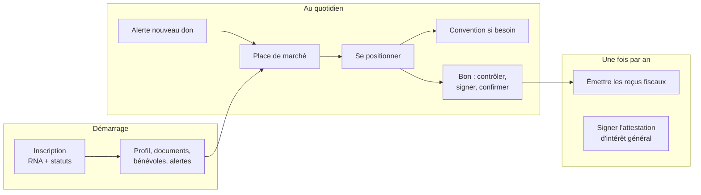

Navigation principale de l'association : **Dons · Mes enlèvements 🆕 · Messages · Archives · Profil**.

### A1 · S'inscrire

- **Écran** : type « Association » ; recherche assistée par dénomination dans la base officielle (pré-remplit adresse et RNA) ; adresse avec auto-complétion ; catégorie d'éligibilité ; catégories de dons souhaitées ; déclaration d'intérêt général ; 🆕 reconnue d'utilité publique (RUP) ; rescrit fiscal demandé ou non ; contact, e-mail, mot de passe.
- **Documents obligatoires** : récépissé RNA et statuts signés ; preuve de rescrit si la case « rescrit demandé » est cochée.
- **Règles** : RNA au format W + 9 chiffres (bloquant) ; e-mail unique ; 🆕 adresse e-mail vérifiée par lien de confirmation avant de se positionner ou de signer ; création de l'association, du compte et des documents **en une seule opération** (tout ou rien) ; la personne qui inscrit l'association en devient administratrice (niveaux d'accès : voir E2).
- **Ce qui se passe** : 🆕 le coordinateur est notifié qu'une nouvelle association est à vérifier ; l'association peut se positionner tout de suite (le badge « Vérifiée » est **informatif**, il ne bloque rien).
- **Recette** : impossible de finir l'inscription sans les deux documents ; le coordinateur voit la nouvelle association dans sa liste « à vérifier ».

### A2 · Compléter son profil

| Rubrique | Contenu | Usage |
|---|---|---|
| Présentation | Types d'activité (épicerie sociale, distribution de colis, repas/maraude), texte libre | Visible des entreprises |
| Disponibilités de retrait | Grille jours × matin/après-midi | 🔧 Visible des entreprises dans le dossier (E5) |
| Préférences d'alerte | 🆕 Rayon de distance et catégories de dons qui l'intéressent, **choisis par l'association** ; canaux e-mail et notification (le SMS est reporté, voir annexe B) | Alerte « nouveau don » (A3) |
| Capacité | Kilos par collecte, nombre de bénéficiaires | Avertissement au positionnement |
| Coffre-fort | 2 documents obligatoires + 8 facultatifs (voir 7.4), dont deux avec modèle PDF pré-rempli à signer | Confiance, conformité |
| Bénévoles | Nom, téléphone, rôle (référent ou collecteur), assurance responsabilité civile attestée, mandat de signature | Choix du collecteur sur le bon |
| Habilitation et conformité | Niveau d'habilitation aide alimentaire (aucune, régionale, nationale) et 🔧 date de fin **prise en compte** ; déclaration DDPP | Loi Garot, badges |
| Statut fiscal | Intérêt général, 🆕 RUP, rescrit (🔧 statut modifiable : non déposé, en attente, accord tacite, réponse reçue) | Reçus fiscaux, badges |
| Contact rappel produit | Personne à prévenir en cas de rappel d'un produit déjà distribué | Sécurité sanitaire |
| Congés | Périodes de fermeture | Bloque les positionnements |
| 🆕 Informations de l'association | Dénomination, adresse, catégories modifiables (RNA fixe) | — |

- **Règles** :
  - 🔧 Une habilitation dont la date de fin est dépassée compte comme **non habilitée**, et l'association est prévenue 30 jours avant ❓.
  - 🔧 Déposer le mandat signé d'un bénévole coche son mandat ; déposer l'habilitation propose de mettre à jour le niveau ❓.
  - Mêmes règles de fichiers que pour l'entreprise.

### A3 · Être alertée d'un nouveau don 🆕

- **Objectif** : ne pas rater un don, surtout un don frais à récupérer vite.
- **Déclencheur** : un don est publié sur la place de marché (E9), ou des articles d'un don divisible redeviennent libres.
- **Destinataires** : les associations dont le **rayon** et les **catégories**, réglés par elles-mêmes dans leur profil (décision de Bruno), correspondent au don, et qui ne sont pas en congés. L'inscription invite l'association à faire ce réglage ; tant qu'elle ne l'a pas fait, ❓ elle reçoit toutes les alertes.
- **Canaux** : **e-mail** et **notification sur l'appareil** si activée. Le message contient l'entreprise, la distance, la nature et le poids estimé, et un lien direct vers le don.
- **Règles** :
  - Envoi à toute heure (décision de Bruno : pas de plage horaire).
  - Une seule alerte par don et par association ; ❓ regroupement si plusieurs dons sont publiés en peu de temps.
  - Lien de désinscription dans chaque e-mail.
  - Le SMS n'est **pas retenu pour l'instant** (annexe B) ; prévoir que l'ajout d'un canal plus tard ne demande pas de refonte.
- **Recette** : une association à 10 km, réglée sur 15 km et la catégorie du don, reçoit l'e-mail et la notification dans la minute qui suit la publication ; une association réglée sur 5 km ou en congés ne reçoit rien.

### A4 · Parcourir la place de marché

- **Écran** : carte ou liste des dons disponibles et des dons qu'elle a réclamés. Pour chaque don : entreprise, distance (🔧 calculée depuis l'adresse de récupération du don), nature, poids estimé, ancienneté (« publié il y a 3 h »), badge « commerçant en congés », état (disponible, positionnée, en attente de validation du donateur).
- **Règles** :
  - Tri : dons non réclamés d'abord, les plus anciens en premier.
  - 🔧 Filtres réels : distance, nature, catégorie.
  - Association en congés : bandeau, boutons désactivés.
  - 🔧 Un don clôturé ou annulé ne s'affiche plus comme « positionnée ».
  - La fiche détaillée du don avant positionnement n'est **pas retenue** pour cette version (voir annexe B) : l'association se décide sur la carte du don.

### A5 · Se positionner sur un don entier

- **Ce qui se passe** : l'association réclame le don. S'il n'y a pas de convention signée avec l'entreprise, elle est guidée vers la convention (A7), puis 🔧 **revient automatiquement** sur le positionnement.
- **Règles** :
  - Pas en congés (bloquant).
  - Convention signée (bloquant, avec redirection).
  - Avertissements non bloquants : entreprise > 400 m² et association non habilitée ; poids du don supérieur à sa capacité. Choix « Annuler » ou « Se positionner quand même ».
  - **Jamais deux attributaires** : si deux associations cliquent en même temps, une seule obtient le don, l'autre reçoit « Ce don vient d'être attribué ».
  - 🔧 Le serveur refuse la voie « don entier » pour un don divisible.
  - Limite : 30 positionnements par heure.
- **Ce qui se passe ensuite** : don **Pris en charge**, bon créé, 🆕 entreprise notifiée.

### A6 · Réclamer une partie d'un don divisible

- **Écran** : liste à cocher des articles encore libres.
- **Ce qui se passe** : les articles sont réservés, un bon « en attente de validation du donateur » est créé, l'entreprise est notifiée (E11). Le don reste visible des autres associations tant que tous les articles ne sont pas réclamés.
- **Règles** : une seule demande à la fois par association et par don ; 🔧 le serveur vérifie que le don est **publié** ; réservation sans conflit si deux associations cochent les mêmes articles en même temps.

### A7 · Signer la convention

Voir E6 : ordre de signature **libre**, notification à l'autre partie.

### A8 · Contrôler, signer et confirmer le bon d'enlèvement

- **Objectif** : vérifier ce qui est remis et le signer.
- **Écran** : pour chaque article (pour un don divisible, seulement ceux réclamés) : allergènes, quantité constatée, température, DLC/DDM constatée et case « Dépassée » (alimentaire), **Valider** ou **Refuser** avec motif. Choix du **bénévole collecteur** (parmi les bénévoles mandatés) ou « Moi-même ».
- **Règles** :
  - Ce que l'entreprise a déclaré est indicatif : les valeurs constatées par l'association font foi.
  - 🔧 **DLC dépassée = refus obligatoire** : cocher « Dépassée » fait passer l'article en « Refusé » (même s'il était validé) et empêche de le valider. Modifier la date ne décoche jamais la case par erreur.
  - Contrôle impossible tant que la demande partielle n'est pas acceptée, ou pendant les congés de l'association (validation comme refus 🔧).
  - **Signature** : seulement après celle de l'entreprise. Le compte de l'association signe ; si un bénévole est choisi, **son nom figure sur le bon** comme personne ayant collecté pour l'association (décision : le bénévole ne signe pas lui-même).
  - Confirmation : voir E12 (poids retenu, date, CO₂ enregistrés ; bon verrouillé ; notification).
- **Recette** : cocher « Dépassée » sur un article validé le fait passer en refusé ; le PDF signé indique le nom du bénévole collecteur.

### A9 · Émettre un reçu fiscal 🆕 (refonte)

- **Objectif** : répondre à la demande annuelle de l'entreprise (E14).
- **Ce qui se passe** : l'association est notifiée d'une demande de reçu. Elle consulte le récapitulatif (bons, articles, quantités) et le montant valorisé par l'entreprise, puis :
  - **émet le reçu** : l'application génère le reçu fiscal pré-rempli (identité de l'association, de l'entreprise, période, montant en chiffres et en lettres, nature des dons, mentions légales), que l'association signe électroniquement ; l'entreprise est notifiée et le reçu est archivé des deux côtés ;
  - ou **conteste** avec un motif (montant, articles), et l'entreprise est notifiée.
- **Règles** :
  - **Bloquant** : une association qui n'a pas, au minimum, **auto-déclaré son intérêt général** ne peut pas émettre ni signer de reçu fiscal (décision de Bruno).
  - **Modèle** : un modèle libre est accepté à condition de reprendre toutes les mentions obligatoires du Cerfa n° 16216 (décision de Bruno).
  - ❓ **Mentions obligatoires et numérotation propre à l'association** (séquentielle par année) : à **valider par un juriste** avant la mise en production.
  - L'association n'accède qu'aux demandes qui lui sont adressées.
- **Recette** : le reçu émis reprend exactement le montant de la demande ; une contestation revient chez l'entreprise avec son motif.

### A10 · Signer l'attestation d'intérêt général

Notification à réception 🆕, signature électronique, archivage ; voir E15.

### A11 · Messagerie

Destinataires : le coordinateur et les entreprises sous convention signée. Mêmes règles qu'en E16.

### A12 · Archives et impact

Bons confirmés, reçus émis et demandes en cours, attestations d'intérêt général, 🔧 filtres réels ; impact cumulé (kilos reçus, CO₂ évité) ; 🆕 historique des demandes refusées et des dons annulés.

---

## 4. Parcours Coordinateur

### 4.0 Le parcours en un coup d'œil

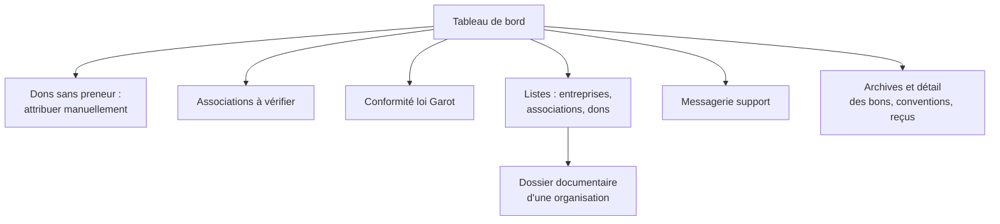

Navigation : **Tableau de bord · Entreprises · Associations · Dons · Messages 🔧 · Archives · Profil**.

### C1 · Avoir un compte coordinateur

- Aucune inscription publique pour ce rôle. 🆕 Un coordinateur existant peut inviter un autre coordinateur par e-mail ❓ ; le premier compte est créé par l'administrateur technique.
- Les coordinateurs partagent la même boîte de messagerie « support ».

### C2 · Piloter avec le tableau de bord

| Indicateur | Définition attendue 🔧 |
|---|---|
| Poids donné ce mois | Somme des poids retenus des bons confirmés dont l'enlèvement a eu lieu ce mois-ci (fuseau Europe/Paris) |
| Dons réalisés | Nombre de **dons** clôturés sur la période choisie (et non le cumul de tous les bons depuis toujours) |
| Taux de refus | Articles refusés ÷ articles contrôlés (validés + refusés) sur la période, dons alimentaires |
| Associations à vérifier | Associations non encore vérifiées |
| CO₂ évité | Somme des CO₂ **enregistrés** à la confirmation des bons, avec équivalent kilomètres |
| Tendance | Poids donné par mois sur 6 mois |
| Conformité loi Garot | Entreprises > 400 m² sans aucune association habilitée **en cours de validité** parmi leurs conventions signées |
| Dons sans preneur | Dons publiés depuis plus de X heures ❓ sans association, les plus anciens en premier |

- 🆕 Sélecteur de période (mois, trimestre, année) et export.

### C3 · Attribuer un don resté sans preneur

- **Objectif** : qu'aucun don ne reste bloqué.
- **Écran** : pour chaque don sans preneur, liste des associations proposées, 🔧 triées par distance et filtrées (pas en congés), avec l'indication « convention signée » ou « convention à signer ».
- **Ce qui se passe** : le don est attribué, le bon est créé, 🆕 l'association **et** l'entreprise sont notifiées. **S'il n'y a pas de convention signée** entre elles, elle est créée et **envoyée automatiquement aux deux parties pour signature** (décision de Bruno) ; le bon n'est signable qu'une fois la convention signée.
- **Règles** :
  - 🔧 Uniquement pour un don **publié**.
  - Don divisible : le coordinateur peut attribuer des articles libres et **valider lui-même** une demande partielle en attente, à la place de l'entreprise (décision de Bruno) ; l'entreprise est informée.
- **Recette** : l'association attributaire reçoit une notification ; un don déjà pris en charge ne peut pas être réattribué.

### C4 · Vérifier une association

- Le coordinateur consulte le dossier documentaire, puis bascule le badge **« Vérifiée »** (avec date et nom du vérificateur).
- Le badge est **informatif** (décision de Bruno) : il rassure les entreprises, il ne bloque rien.
- 🆕 L'association est notifiée de la vérification. ❓ Le badge est retiré automatiquement si un document obligatoire est remplacé.

### C5 · Consulter les listes et les dossiers

- **Entreprises** : raison sociale, SIRET, nature d'activité, enseigne, Kbis fourni, grande surface ; recherche et filtres (« Grande surface », « Kbis manquant »).
- **Associations** : dénomination, RNA, rescrit, habilitation, vérification ; filtres (« À vérifier », « Non habilitée »).
- **Dons** : tous les dons hors brouillons, filtres par état, 🆕 lien vers le bon.
- **Dossier documentaire** d'une organisation : chaque document attendu, fourni ou manquant, consultable ; conventions signées. Lecture seule.
- 🔧 Recherche globale fonctionnelle dans l'en-tête.
- 🔧 Accès en lecture au **détail** des bons, conventions et reçus (pas seulement à leurs PDF).

### C6 · Suivre la conformité loi Garot

Liste des entreprises « à risque » (voir C2), avec action 🆕 « Écrire à l'entreprise » pour l'accompagner.

### C7 · Messagerie support

Le coordinateur voit toutes les conversations « support » et peut écrire à toute entreprise ou association, sans condition de convention.

### C8 · Enseignes et réseaux

Regroupements de plusieurs établissements (enseigne) ou antennes associatives (réseau), avec abonnement. Dans la V1, ces données existent sans écran de gestion : ❓ **hors périmètre** de la reconstruction tant que le modèle commercial n'est pas défini (voir annexe B).

---

## 5. Interactions entre les rôles

### 5.1 Le don de bout en bout

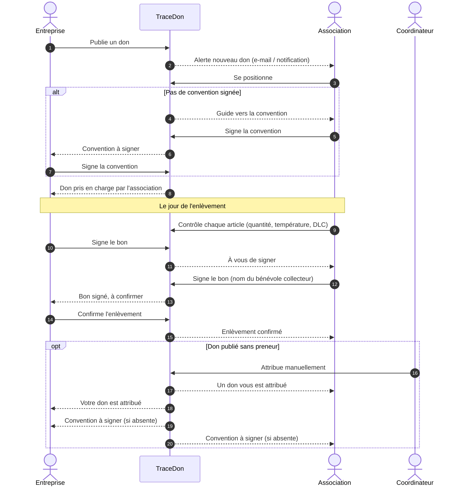

### 5.2 Le reçu fiscal annuel

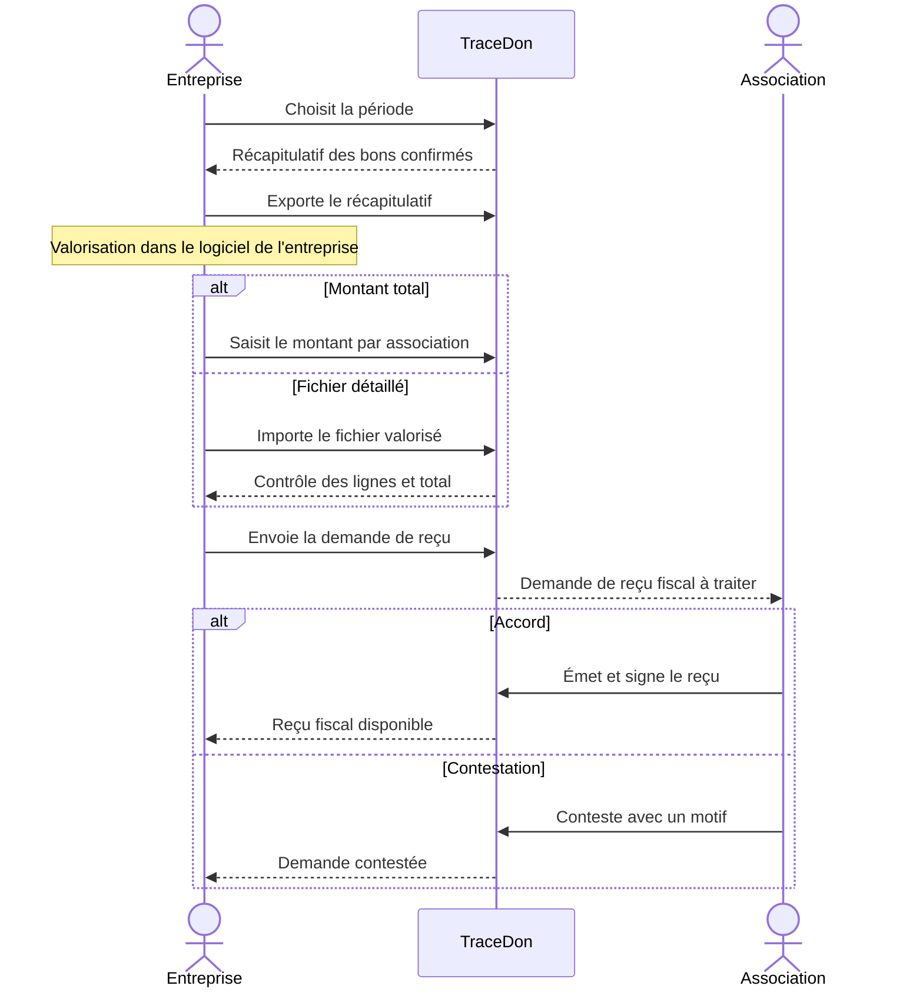

### 5.3 Toutes les notifications

Chaque notification part par **e-mail** et par **notification sur l'appareil** (si activée), sauf mention SMS. Un échec d'envoi n'annule jamais l'action qui l'a déclenchée.

| Événement | Destinataire | V1 |
|---|---|---|
| Nouveau don publié correspondant à ses réglages (rayon, catégories) | Associations concernées | 🆕 |
| Articles d'un don divisible de nouveau libres | Associations concernées | 🆕 |
| Don attribué par le planning | Association | 🆕 |
| Don attribué par le coordinateur | Association et entreprise | 🆕 |
| Positionnement sur un don entier | Entreprise | 🆕 |
| Demande partielle sur un don divisible | Entreprise | Existe |
| Demande partielle acceptée / refusée | Association | Existe |
| Convention à signer / signée | L'autre partie | 🆕 |
| L'entreprise a signé le bon | Association | Existe |
| L'association a signé le bon | Entreprise | Existe |
| Enlèvement confirmé | Les deux parties | 🆕 |
| Don annulé par l'entreprise | Association attributaire | 🆕 |
| Planning suspendu par des congés, ou réactivé | Associations planifiées | 🆕 |
| Convention envoyée par le coordinateur | Les deux parties | 🆕 |
| Demande partielle validée par le coordinateur | Entreprise | 🆕 |
| Invitation à rejoindre une organisation, e-mail à vérifier | Utilisateur invité ou inscrit | 🆕 |
| Demande de reçu fiscal reçue | Association | 🆕 |
| Reçu émis / demande contestée | Entreprise | 🆕 |
| Attestation d'intérêt général à signer / signée | Association / entreprise | 🆕 |
| Nouvelle association inscrite | Coordinateurs | 🆕 |
| Association vérifiée | Association | 🆕 |
| Habilitation bientôt expirée | Association | 🆕 |
| Nouveau message | Destinataire (priorité indiquée) | Existe |

---

## 6. États et règles métier

### 6.1 Cycle de vie d'un don

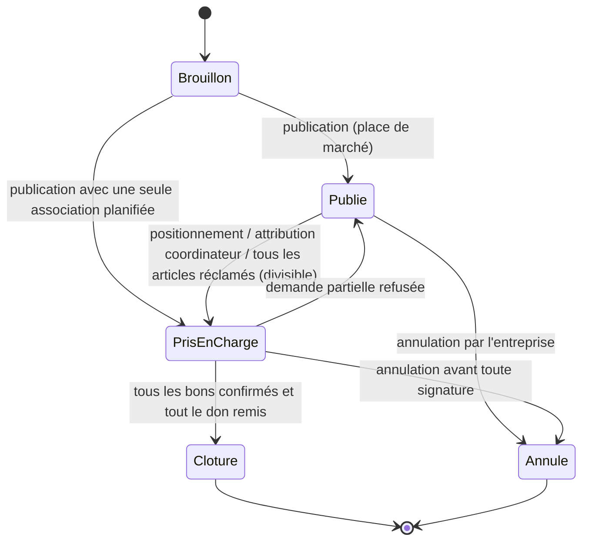

| État | Signification | Visible par |
|---|---|---|
| Brouillon | En préparation, un seul brouillon par type et par entreprise | Entreprise |
| Publié | Sur la place de marché, sans preneur (ou partiellement réclamé si divisible) | Entreprise, associations, coordinateur |
| Pris en charge | Attribué, bon(s) en cours | Entreprise, association(s) attributaire(s), coordinateur |
| Clôturé | Tous les bons confirmés | Tous les concernés, archives |
| Annulé | Retiré avec motif, définitif | Entreprise, association concernée, coordinateur |

### 6.2 Article

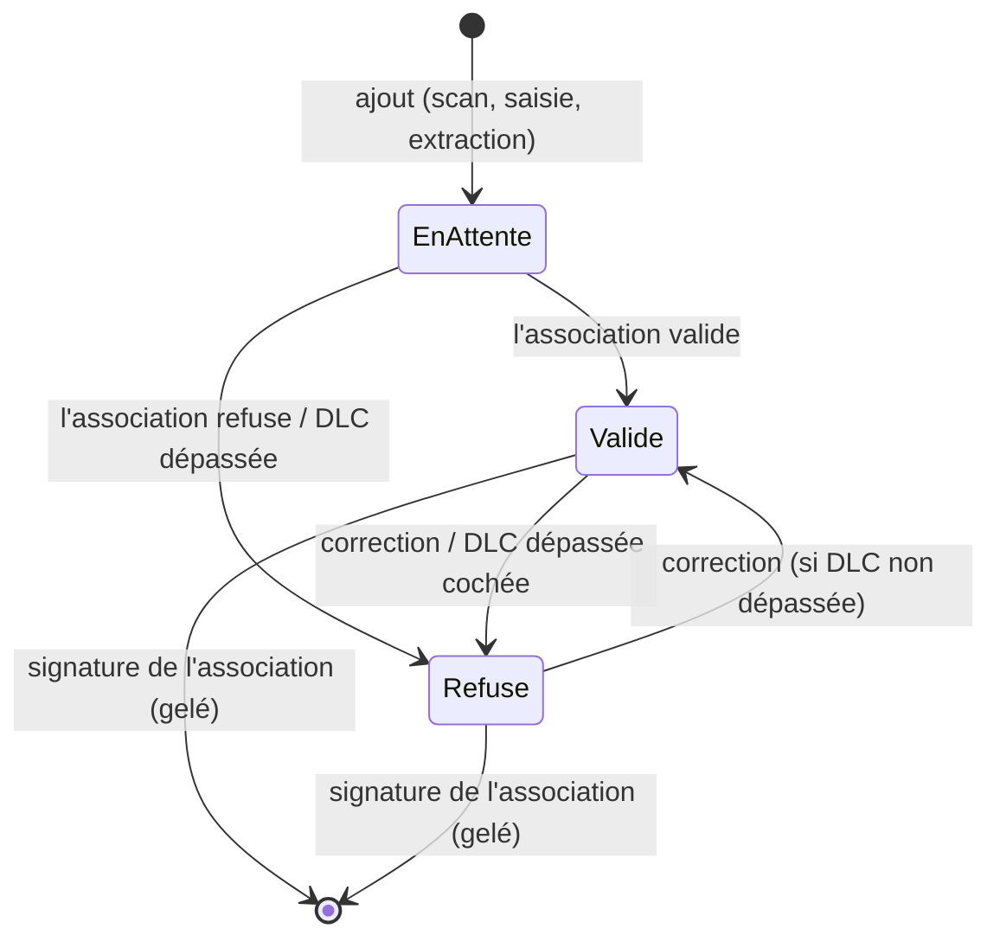

Un article en attente peut être retiré par l'entreprise tant qu'elle n'a pas signé et qu'il n'est pas réclamé.

### 6.3 Bon d'enlèvement

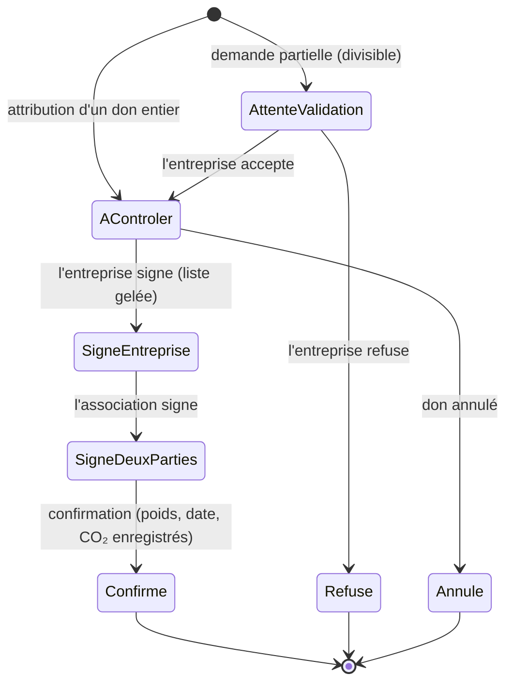

🔧 Dans la V1, ces états étaient déduits de plusieurs champs (dates de signature, booléens) et le bon refusé était supprimé. La reconstruction utilise un **statut explicite** et conserve l'historique.

### 6.4 Convention, reçu fiscal, attestation d'intérêt général

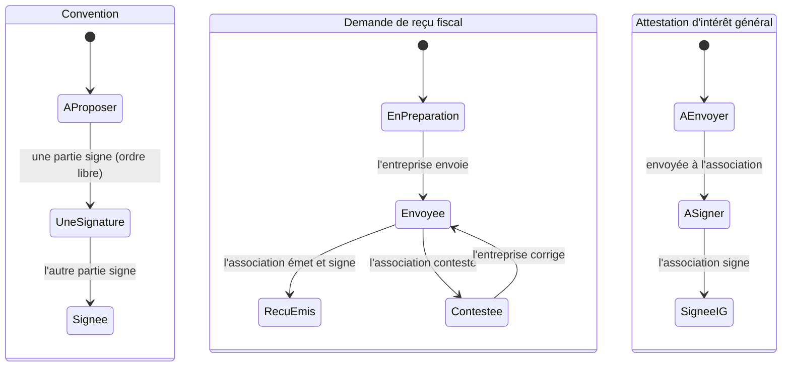

### 6.5 Règles métier consolidées

| N° | Règle | Type |
|---|---|---|
| R1 | Pas de publication sans Kbis déposé | Bloquant |
| R2 | Congés de l'entreprise : attributions du planning suspendues, réactivables à la main. Congés de l'association : positionnement impossible | Automatique / bloquant |
| R3 | Pas de don entre une entreprise et une association sans convention signée | Bloquant |
| R4 | Entreprise > 400 m² : au moins une association habilitée **en cours de validité** parmi ses partenaires (loi Garot) | Avertissement, suivi coordinateur |
| R5 | Poids du don > capacité déclarée de l'association | Avertissement |
| R6 | Produit sous rappel officiel actif : ajout impossible | Bloquant |
| R7 | DLC/DDM dépassée : refus obligatoire de l'article | Bloquant |
| R8 | Un don non divisible a une seule association attributaire, même en cas de clics simultanés | Bloquant |
| R9 | Don divisible : toute réclamation partielle doit être acceptée par l'entreprise avant contrôle et signature | Bloquant |
| R10 | Bon : l'entreprise signe d'abord, l'association ensuite ; le document signé reflète le contrôle final | Bloquant |
| R11 | Après la signature de l'entreprise, la liste d'articles du bon est gelée | Bloquant |
| R12 | Confirmation : deux signatures et aucun article en attente | Bloquant |
| R13 | Bon confirmé : définitivement non modifiable (registre légal) | Bloquant |
| R14 | Convention : ordre de signature libre, reconduction tacite sans date de fin | — |
| R15 | Un bon confirmé ne figure que dans une seule demande de reçu fiscal | Bloquant |
| R16 | Numéros (bons, demandes, reçus) uniques et séquentiels par année, sans doublon possible | Bloquant |
| R17 | Toutes les dates et jours de la semaine en fuseau Europe/Paris | — |
| R18 | La dispense de reversement de TVA ne concerne que les dons aux associations **RUP** ; la réduction de 60 % concerne les associations d'**intérêt général** (information affichée, pas de calcul fiscal par l'application) | Information |
| R19 | Pas de reçu fiscal émis par une association qui n'a pas au minimum auto-déclaré son intérêt général | Bloquant |
| R20 | Bon signé par au moins une partie : plus d'annulation possible | Bloquant |
| R21 | Chaque action est réservée aux utilisateurs dont le niveau d'accès le permet (administrateur, opérateur, lecture), vérifié côté serveur | Bloquant |

---

## 7. Socle transverse

### 7.1 Sécurité (la « ligne rouge » de TraceDon)

1. Tout passe en HTTPS, imposé au navigateur.
2. Mots de passe hachés à sens unique, jamais lisibles.
3. Aucune requête à la base construite à partir de texte saisi (pas d'injection).
4. **Cloisonnement** : chaque utilisateur ne voit et ne modifie que les données de son organisation, **vérifié côté serveur sur chaque action et chaque fichier**, même si l'identifiant est modifié dans l'adresse. Le coordinateur voit tout, en lecture, et ne modifie que la vérification et l'attribution.
5. Les clés des services externes ne quittent jamais le serveur (seule une clé cartographique restreinte au domaine peut être publique).
6. **Limites de fréquence** partagées entre tous les serveurs, sur chaque action (voir 7.2).
7. Sauvegardes de la base, testées par une restauration réelle.
8. Rien de ce qui sert aux tests (comptes de démo, données fictives, outils de bascule de profil) n'existe en production. **Base de test séparée** de la production.

Autres protections : session non affichable dans un autre site, vérification des adresses de notification (pas d'appel serveur vers une adresse interne), noms de fichiers nettoyés, contrôle du type réel des fichiers.

### 7.2 Limites anti-abus (valeurs de départ)

| Action | Limite |
|---|---|
| Toute action d'un utilisateur connecté | 600 par 5 min |
| Connexion (par e-mail) | 10 par 5 min |
| Inscription (par connexion internet) | 5 par heure |
| Recherches d'entreprise ou d'adresse à l'inscription | 30 par minute |
| Publication / positionnement | 30 par heure chacun |
| Envoi de fichiers | 30 par heure |
| Extraction d'articles par IA | 10 par heure |
| Lancement d'une signature électronique (par document) | 10 par 5 min |
| Envoi de messages | 20 par 5 min |
| Téléchargement de documents | 60 par 5 min |

### 7.3 Signature électronique

| Document | Signataires | Ordre |
|---|---|---|
| Convention de don | Entreprise et association | Libre 🔧 |
| Bon d'enlèvement | Entreprise puis association (le bénévole est nommé, il ne signe pas) | Imposé |
| Reçu fiscal | Association | — |
| Attestation d'intérêt général | Association | — |

- Signature **dans l'application**, sans redirection vers un site externe.
- **Anti-fraude** : au retour d'une signature, l'application revérifie auprès du service de signature que la signature est réellement complète avant de l'enregistrer.
- 🔧 Le document signé est **récupéré et archivé** ; c'est lui qui fait foi, pas un PDF régénéré.
- Le PDF du bon porte un QR code vers le bon ; les montants financiers sont écrits en chiffres et en lettres.
- **Niveau de signature : à proposer par le développeur.** Bruno ne connaît pas les différents niveaux (simple, avancée, qualifiée au sens du règlement européen eIDAS) : le développeur lui présente, avant de coder, ce que chacun garantit, son coût et sa lourdeur pour l'utilisateur, et recommande un niveau par type de document. Utiliser l'environnement de **production** du prestataire (la V1 affichait « qualifiée » mais utilisait l'environnement de démonstration, sans valeur légale).

### 7.4 Documents

| Organisation | Obligatoires | Facultatifs |
|---|---|---|
| Entreprise | Extrait Kbis | — |
| Association | Récépissé RNA, statuts signés | Attestation d'assurance, preuve de rescrit fiscal, habilitation aide alimentaire, déclaration DDPP, PV d'assemblée générale, assurance transport/stockage, attestation chaîne du froid (modèle pré-rempli fourni), mandat de signature d'un bénévole (modèle pré-rempli fourni) |

Formats PDF, JPEG, PNG, WebP ; 5 Mo ; un document par type et par organisation, remplaçable ; 🔧 stockage dans un service de fichiers dédié plutôt que dans la base de données.

### 7.5 Services externes

| Service | Usage | Si indisponible |
|---|---|---|
| Signature électronique (DocuSign dans la V1) | Conventions, bons, reçus, attestations | Signature impossible, message clair |
| Cartographie (Google Maps dans la V1) | Carte, géocodage, distances (🔧 avec mise en cache) | Liste sans carte, distance « — » |
| Calcul CO₂ (Impact CO₂ / ADEME Agribalyse) | CO₂ évité par catégorie de produit | Valeur non affichée |
| IA d'extraction (Gemini dans la V1) | Liste d'articles depuis une photo ou un PDF | Bouton masqué |
| E-mail transactionnel (Resend dans la V1) | Notifications | Notification perdue, action réussie |
| SMS (reporté, voir annexe B) | Alerte nouveau don, plus tard | — |
| Notifications push (standard du navigateur) | Notifications sur l'appareil | Bouton masqué |
| Open Food Facts | Désignation, poids, allergènes au scan | Saisie manuelle |
| RappelConso (data.economie.gouv.fr) | Rappels produits | Ajout autorisé |
| Recherche d'entreprises (api.gouv.fr) | SIRET et RNA à l'inscription | Saisie manuelle |
| Géoplateforme IGN | Auto-complétion d'adresse | Saisie libre |
| Mesure d'audience (PostHog dans la V1) | Statistiques d'usage, **uniquement avec consentement** | Rien n'est mesuré |

Principe : **l'absence d'un service ne fait jamais planter l'application**.

### 7.6 Données personnelles

Consentement préalable à toute mesure d'audience, modifiable à tout moment ; aucune donnée personnelle dans les adresses de pages ; durées de conservation à définir ❓ (les bons et reçus relèvent des obligations comptables) ; 🆕 export et suppression du compte sur demande.

---

## Annexe A · Écarts de la V1 et pièges à ne pas reproduire

| Sujet | Ce que faisait la V1 | Attendu |
|---|---|---|
| Valeur des dons | Calculait un montant (poids × coût au kilo jamais saisissable → 0 €) | Valorisation par l'entreprise, reçu émis par l'association (E14, A9) |
| Alerte nouveau don | Aucune, malgré une préférence e-mail/SMS dans le profil | E-mail, SMS, notification (A3) |
| Suivi entreprise | Aucune liste des dons en cours | « Mes dons » (E10) |
| Annulation | Seulement via les congés, sans prévenir personne | Annulation avec motif et notification (E13) |
| PDF signé du bon | Figé au premier clic de signature, avant le contrôle de l'association | Généré au moment de la signature, archivé (E12) |
| Liste d'articles après signature | Modifiable jusqu'à la confirmation | Gelée dès la signature de l'entreprise (R11) |
| Confirmation | Possible avec des articles non contrôlés | Bloquée (R12) |
| DLC dépassée | Contournable (article déjà validé, champ date qui décochait la case) | Refus automatique (R7) |
| Convention | Ordre imposé techniquement, présenté comme libre à l'écran | Ordre libre (R14) |
| Bon d'un don annulé | Restait signable et confirmable | Bloqué |
| Republication | Un don déjà pris en charge pouvait être republié | Seul un brouillon se publie |
| Don divisible | Contournement possible de la validation du donateur par appel direct | Refusé côté serveur |
| Numérotation | « nombre + 1 » : doublons possibles, compteur non annuel | Séquence annuelle sans doublon (R16) |
| Création de compte | Organisation et utilisateur créés séparément | Tout ou rien |
| Habilitation | Date de fin ignorée | Prise en compte (R4) |
| CO₂ | Recalculé à chaque affichage, jamais enregistré | Enregistré à la confirmation |
| Fuseau horaire | Heure du serveur (jour du planning faux en soirée) | Europe/Paris (R17) |
| Distances | Depuis l'adresse de l'entreprise, sans cache | Depuis l'adresse de récupération, avec cache |
| Coordinateur | Pas de page de détail des bons, recherche factice, pas de lien Messages | Détail en lecture, recherche, messagerie |
| Filtres | Boutons « Filtrer » et puces d'archives décoratifs | Filtres fonctionnels |
| Fichiers | Stockés dans la base de données | Service de fichiers dédié |
| Base de test | Partagée avec la production | Séparée (7.1, point 8) |
| Données de démo | Le script de démo vidait presque toutes les tables | Jamais exécutable en production |

## Annexe B · Hors périmètre de cette version

- Fiche détaillée d'un don visible par l'association **avant** positionnement (non retenu).
- Gestion des enseignes, réseaux et abonnements (modèle commercial à définir).
- Signature personnelle du bénévole (décision : l'association signe pour lui).
- Calcul fiscal par l'application (décision : la valorisation reste chez l'entreprise).
- Alertes par **SMS** (non retenu pour l'instant, décision de Bruno) : l'architecture des notifications doit permettre d'ajouter ce canal plus tard.
- Application mobile native (l'application web doit fonctionner sur téléphone et pouvoir s'installer sur l'écran d'accueil).

## Annexe C · Décisions de Bruno et points restant à préciser

### Décisions prises le 9 octobre 2026

| N° | Question | Décision |
|---|---|---|
| 1 | Alertes « nouveau don » : rayon, filtres, horaires, SMS | Rayon et catégories réglés par l'association ; envoi à toute heure ; SMS non retenu pour l'instant (e-mail et notification) |
| 2 | Congés de l'entreprise | Suspension automatique des dons récurrents (planning) pendant la période ; réactivation manuelle possible pendant la période |
| 3 | Attribution par le coordinateur | Convention envoyée automatiquement aux deux parties pour signature ; une demande partielle sur un don divisible peut être validée par l'entreprise ou par le coordinateur |
| 4 | Annulation d'un bon signé par une partie | Non |
| 5 | Durée de la convention et de l'attestation d'intérêt général | Convention reconduite tacitement ; attestation d'intérêt général valable sans limite |
| 6 | Reçu fiscal | Une association qui n'a pas au minimum auto-déclaré son intérêt général ne peut pas signer de reçu ; modèle libre accepté s'il reprend les mentions obligatoires du Cerfa ; mentions et numérotation à valider par un juriste |
| 7 | Niveau de signature électronique | Le développeur présente les niveaux à Bruno et recommande |
| 8 | Documents d'une association visibles par les entreprises | Oui |
| 9 | Plusieurs utilisateurs par organisation | Oui, avec plusieurs niveaux d'accès |
| 10 | Vérification de l'e-mail à l'inscription | Oui |

### Points restant à préciser

1. **Juriste** : mentions obligatoires du reçu fiscal et numérotation propre à l'association.
2. **Développeur → Bruno** : comparatif des niveaux de signature électronique et recommandation.
3. **Niveaux d'accès** : valider la liste proposée en E2 (administrateur, opérateur, lecture) et les préférences de notification par utilisateur.
4. **Congés** : publication d'un don ponctuel pendant les congés (proposé : autorisée avec avertissement).
5. **Alertes** : comportement tant que l'association n'a pas réglé son rayon (proposé : toutes les alertes) ; regroupement de plusieurs dons publiés en peu de temps.
6. **Convention** : modalités de résiliation par l'une des parties.

## Annexe D · Repères dans le code de la V1

Pour consulter le comportement d'origine (application Next.js, base PostgreSQL via Prisma) :

| Sujet | Où regarder |
|---|---|
| Modèle de données et statuts | `prisma/schema.prisma` |
| Actions métier du don (publier, se positionner, contrôler, confirmer, attribuer) | `src/app/actions.ts` |
| Inscription, connexion, profil | `src/app/inscription/`, `src/app/connexion/`, `src/app/profil/actions.ts` |
| Planning | `src/app/planning/actions.ts` |
| Bon d'enlèvement et signature | `src/app/bon-enlevement/[bonId]/`, `src/lib/docusign.tsx` |
| Conventions, attestations | `src/app/convention/`, `src/app/attestations/`, `src/app/attestation-interet-general/` |
| Coordinateur | `src/app/coordinateur/` |
| Notifications | `src/lib/notifications.ts`, `src/lib/email.ts`, `src/lib/webPush.ts` |
| Limites de fréquence | `src/lib/rateLimiter.ts`, `src/lib/sessionLimitee.ts` |
| Contrôle des accès par rôle | `src/middleware.ts`, `src/lib/auth.ts` |
| Documents | `src/lib/documents.ts` |
| CO₂, rappels, produits, adresses | `src/lib/impactCo2.ts`, `src/lib/rappelConso.ts`, `src/lib/openFoodFacts.ts`, `src/lib/ignAdresse.ts` |
| Manuel fonctionnel de la V1 | `docs/manuel.html` |
| Audits de sécurité | `docs/audits/` |

## Lexique

- **Loi Garot (2016)** : oblige les commerces alimentaires de plus de 400 m² à proposer une convention de don à au moins une association habilitée.
- **Loi AGEC (2020)** : interdit la destruction des invendus non alimentaires neufs.
- **Habilitation aide alimentaire** : autorisation régionale ou nationale de distribuer des denrées.
- **RNA** : Répertoire national des associations (W + 9 chiffres).
- **SIRET** : identifiant d'établissement à 14 chiffres. **Kbis** : extrait d'immatriculation d'une société.
- **DDPP** : Direction départementale de la protection des populations ; déclaration obligatoire pour manipuler des denrées d'origine animale.
- **Rescrit fiscal** : confirmation par l'administration de l'éligibilité d'une association au mécénat.
- **Intérêt général** : statut ouvrant droit à la réduction d'impôt de 60 % (art. 238 bis du CGI) pour l'entreprise donatrice.
- **RUP** : association reconnue d'utilité publique ; les dons qui lui sont faits sont dispensés de régularisation de la TVA déduite à l'achat.
- **DLC / DDM** : date limite de consommation / date de durabilité minimale.
- **Bon d'enlèvement** : registre signé de ce qui a été remis, article par article.
- **Convention de don** : contrat cadre entre une entreprise et une association.
- **Reçu fiscal** : document émis par l'association, permettant à l'entreprise de justifier sa réduction d'impôt.
